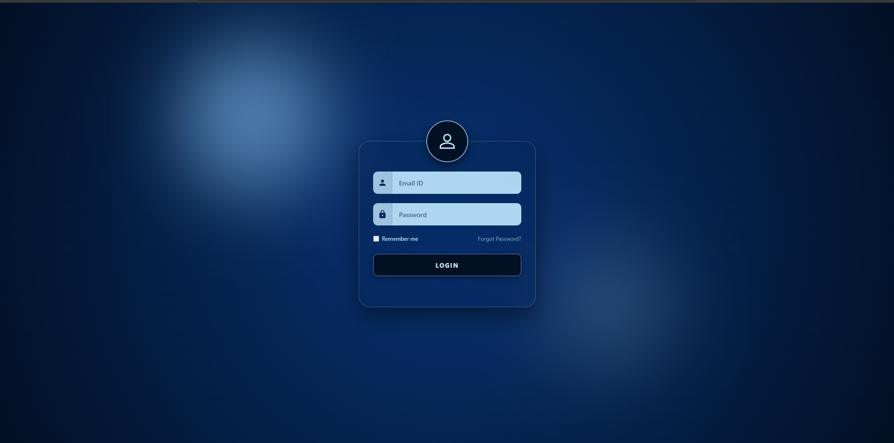
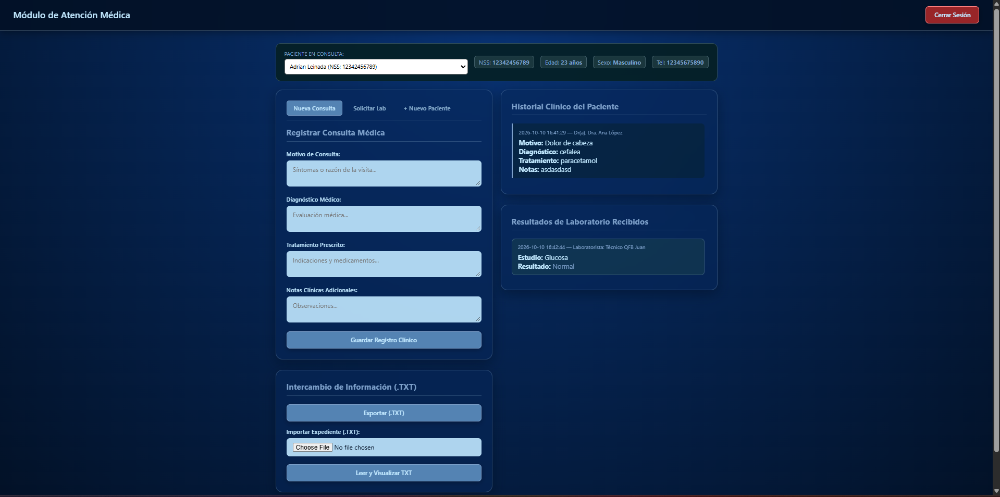
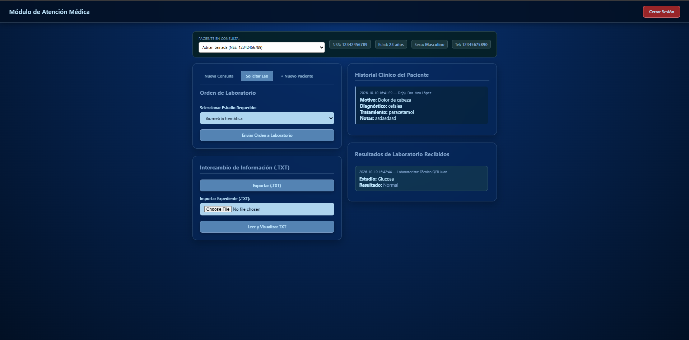
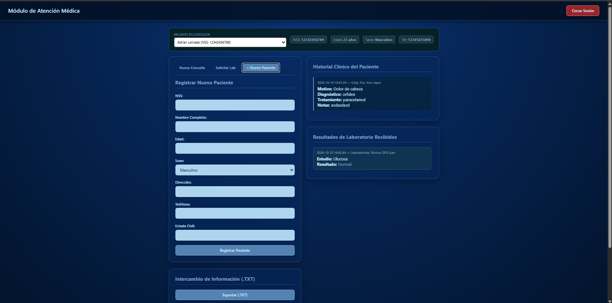
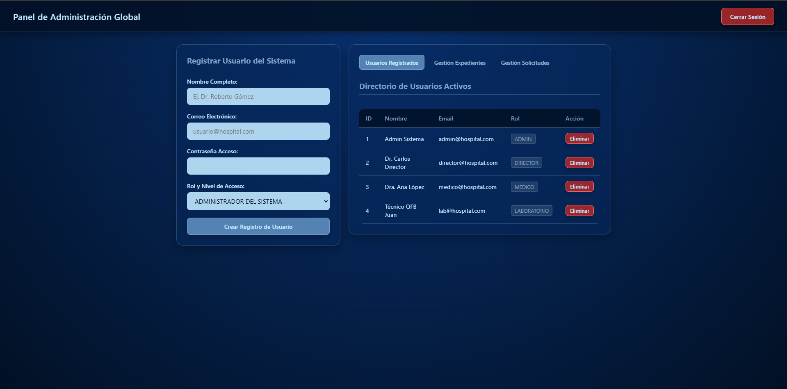
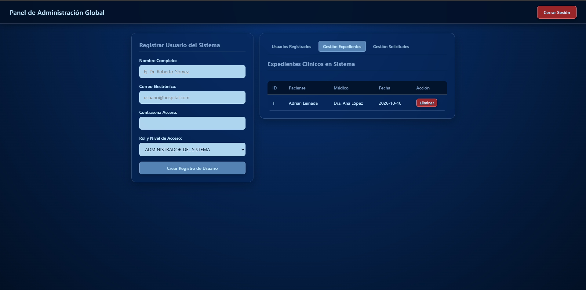
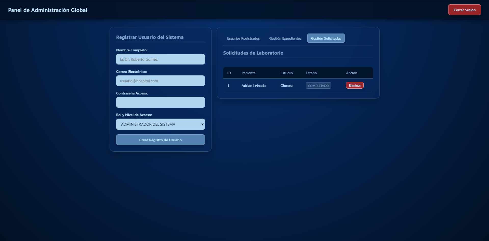
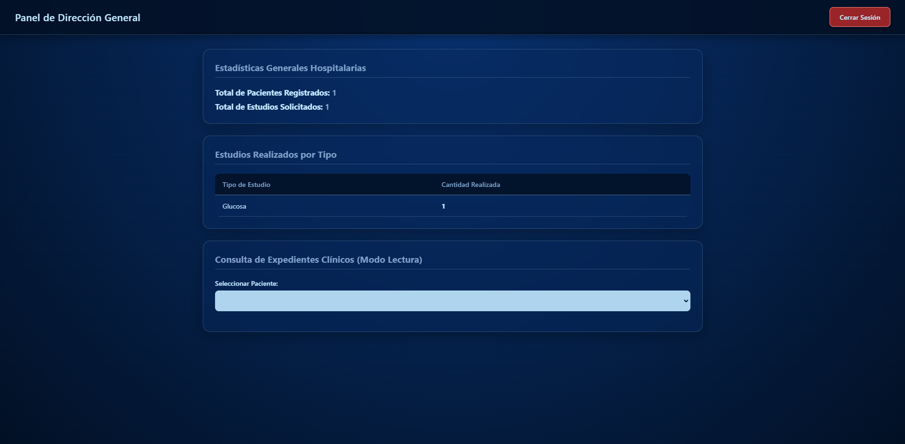
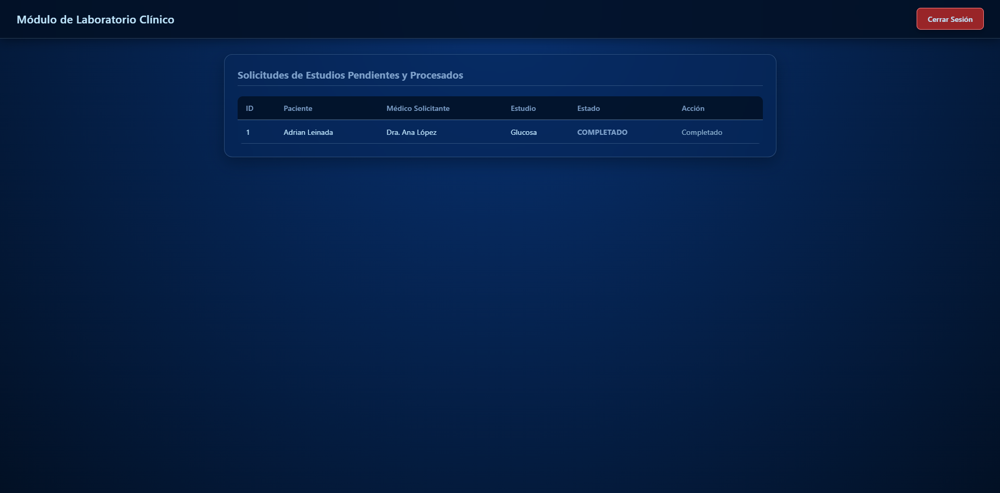

# Sistema Web de Gestión Hospitalaria para Telemedicina

Sistema web desarrollado para la administración de expedientes clínicos, control de solicitudes de laboratorio e intercambio de información médica mediante mensajes estandarizados HL7 v2.x (ADT^A08) en archivos .txt.

## Capturas de Pantalla e Interfaz del Sistema

### Inicio de Sesión
<p align="center">
  
</p>

### Módulo de Atención Médica
| Consulta Médica | Orden de Laboratorio |
| :---: | :---: |
|  |  |

<div align="center">

| Registro de Nuevo Paciente |
| :---: |
|  |

</div>

### Panel de Administración Global
| Usuarios Registrados | Gestión de Expedientes |
| :---: | :---: |
|  |  |

<div align="center">

| Gestión de Solicitudes |
| :---: |
|  |

</div>

### Dashboard de Dirección General
<p align="center">
  
</p>

### Módulo de Laboratorio Clínico
<p align="center">
  
</p>

---

## Tecnologías Utilizadas

* **Backend:** Node.js, Express.js
* **Base de Datos:** SQLite3
* **Frontend:** HTML5, CSS3 (Glassmorphism / Layout Grid), JavaScript Vanilla
* **Autenticación:** Express Session, Bcryptjs
* **Estándar Interoperabilidad:** HL7 v2.x (ADT^A08)
* **Manejo de Archivos:** Multer (Importación/Exportación de mensajes HL7 en .TXT)

---

## Perfiles de Usuario y Credenciales de Prueba

* **Contraseña predeterminada para todos los usuarios:** `123456`

| Rol | Correo de Acceso | Descripción de Permisos |
| :--- | :--- | :--- |
| **Administrador** | `admin@hospital.com` | Gestión de usuarios, expedientes y solicitudes de laboratorio. |
| **Director General** | `director@hospital.com` | Visualización de estadísticas hospitalarias y lectura de expedientes. |
| **Médico** | `medico@hospital.com` | Alta de pacientes, historial clínico, solicitudes e importación/exportación HL7 v2.x. |
| **Laboratorio** | `lab@hospital.com` | Procesamiento de órdenes de análisis y captura de resultados. |

---

## Instrucciones de Instalación y Ejecución

1. Clonar el repositorio:
   ```bash
   git clone [https://github.com/Somohanito/Sistema-telesalud.git](https://github.com/Somohanito/Sistema-telesalud.git)
   cd Sistema-telesalud